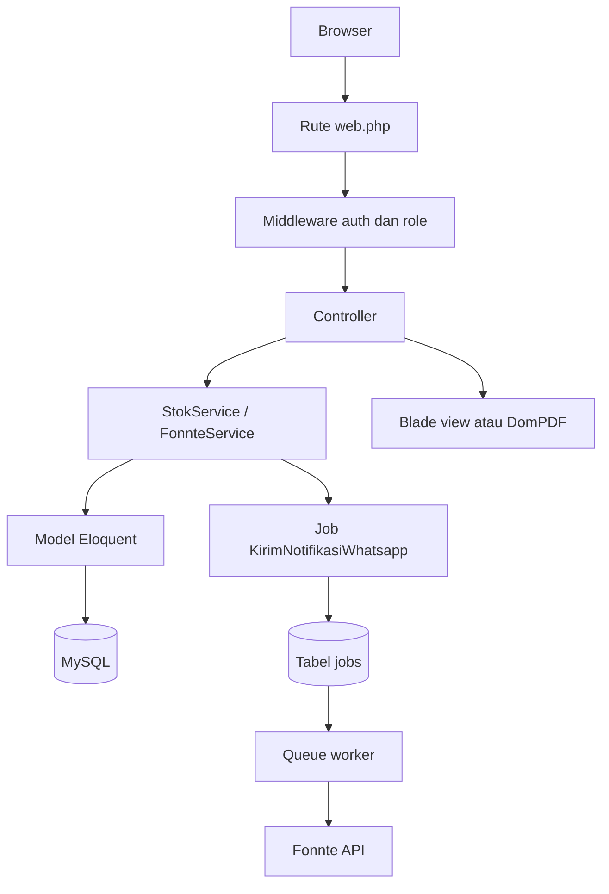
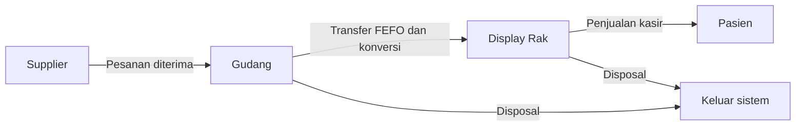
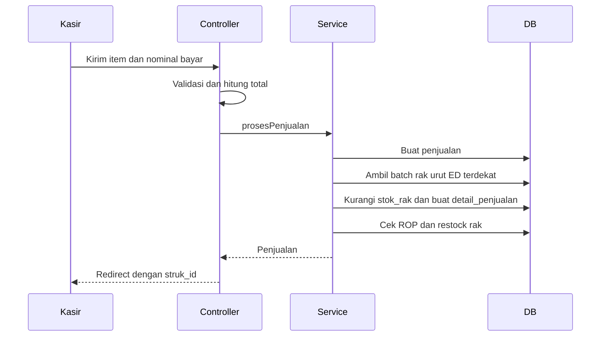
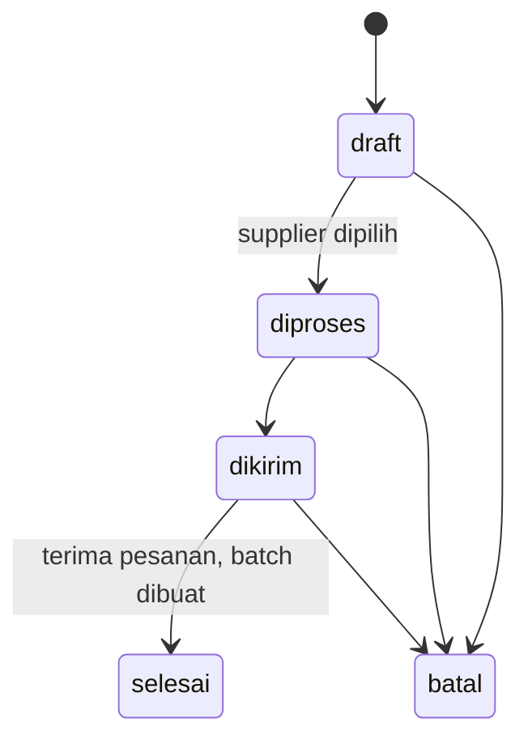
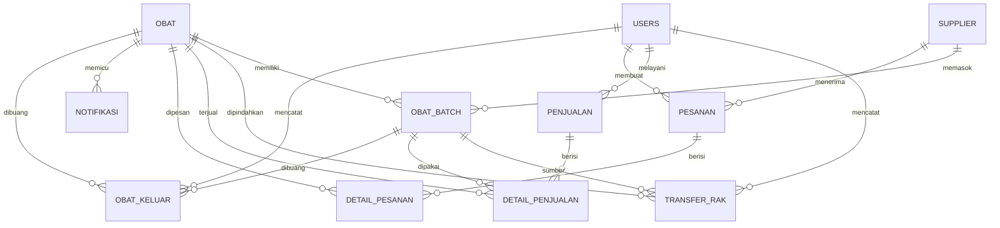

# Dokumentasi Sistem Inventaris Obat Apotek Tabah Farma

Dokumen ini menjelaskan sistem informasi manajemen stok obat Apotek Tabah Farma: struktur folder, arsitektur, model data, alur bisnis, aturan perhitungan, konfigurasi, dan catatan teknis. Isi dokumen disusun dari kode yang ada di repositori ini.

| Atribut | Nilai |
|---|---|
| Nama sistem | SIM Stok Obat Apotek Tabah Farma |
| Basis kode | Laravel 12, Blade, Tailwind CSS v4, Alpine.js |
| Domain utama | Inventaris multi-lokasi, FEFO, ROP, POS kasir, notifikasi WhatsApp, laporan PDF |
| Database | MySQL (produksi), SQLite in-memory (pengujian) |
| Bahasa antarmuka | Indonesia |
| Zona waktu | `Asia/Jakarta` |

---

## 1. Ringkasan Sistem

Sistem ini mencatat perpindahan stok obat melalui empat titik utama:

1. Penerimaan obat dari supplier ke gudang, dicatat per batch dengan tanggal kadaluwarsa.
2. Transfer obat dari gudang ke display rak, memakai urutan FEFO (First Expired First Out) dan konversi satuan.
3. Penjualan di kasir dari stok rak, juga memakai FEFO per batch.
4. Pembuangan obat expired atau rusak melalui modul disposal.

Di atas alur tersebut, sistem menjalankan tiga pengawasan:

- ROP dinamis untuk memicu draft pesanan dan notifikasi stok menipis.
- Peringatan restock rak ketika stok rak menyentuh batas minimum.
- Peringatan batch yang mendekati tanggal kadaluwarsa.

Semua peringatan dicatat di tabel `notifikasi` dan dikirim ke WhatsApp melalui API Fonnte memakai queue.

---

## 2. Teknologi

| Lapisan | Teknologi | Keterangan |
|---|---|---|
| Bahasa | PHP 8.2+ | Batas minimum dari `composer.json` |
| Framework | Laravel 12 | Routing, Eloquent, queue, scheduler, validasi |
| Templating | Blade | Layout dan komponen halaman |
| CSS | Tailwind CSS v4 | Plugin `@tailwindcss/vite` |
| Interaksi | Alpine.js 3 | Sidebar, tema, modal, komponen form |
| Grafik | ApexCharts | Grafik dashboard |
| Kalender | FullCalendar | Komponen kalender bawaan tema |
| Tanggal | Flatpickr | Input tanggal |
| Build | Vite 7 | Aset CSS dan JS |
| PDF | barryvdh/laravel-dompdf | Surat pesanan dan laporan |
| WhatsApp | Fonnte API | Pengiriman notifikasi |
| Queue | Database driver | Job `KirimNotifikasiWhatsapp` |
| Pengujian | Pest 4 dan PHPUnit | `php artisan test` |
| Tema awal | TailAdmin Laravel | Banyak komponen dan halaman demo masih tersisa |

Catatan: dokumen `Perancangan_Sistem_Stok_Obat_Laravel.md` masih menyebut Laravel 11 dan dua role, sedangkan `README.md` masih memakai deskripsi template TailAdmin. Kode aktual memakai Laravel 12 dan tiga role: `admin`, `karyawan`, `owner`.

---

## 3. Struktur Folder

```text
sistem-inventaris-rop-fefo/
├── app/
│   ├── Console/Commands/          Perintah artisan
│   ├── Helpers/                   Helper menu sidebar
│   ├── Http/
│   │   ├── Controllers/           Controller per modul
│   │   └── Middleware/            Middleware role
│   ├── Jobs/                      Job queue notifikasi WhatsApp
│   ├── Models/                    Model Eloquent
│   ├── Providers/                 Service provider
│   ├── Services/                  Logika bisnis stok dan Fonnte
│   └── View/Components/           Komponen Blade berbasis kelas
├── bootstrap/
│   ├── app.php                    Konfigurasi routing dan middleware
│   └── cache/                     Cache framework
├── config/                        Konfigurasi Laravel
├── database/
│   ├── factories/                 Factory model
│   ├── migrations/                Skema database
│   └── seeders/                   Data awal
├── public/
│   ├── build/                     Hasil build Vite
│   └── images/                    Logo dan aset gambar
├── resources/
│   ├── css/app.css                Tema Tailwind dan variabel desain
│   ├── js/                        Entry point dan komponen JS
│   └── views/
│       ├── components/            Komponen Blade
│       ├── layouts/               Layout utama
│       └── pages/                 Halaman aplikasi
├── routes/
│   ├── console.php                Scheduler
│   └── web.php                    Semua rute web
├── storage/                       Log, cache view, file sementara
├── tests/                         Unit dan feature test
├── .agents/                       Skill agen, bukan bagian aplikasi
├── .env.example                   Contoh konfigurasi lingkungan
├── composer.json                  Dependensi PHP
├── package.json                   Dependensi frontend
└── vite.config.js                 Konfigurasi Vite
```

Folder `vendor/` dan `node_modules/` tidak termasuk kode aplikasi dan tidak perlu dibaca untuk memahami sistem.

### 3.1 Folder aplikasi

| Path | Isi |
|---|---|
| `app/Console/Commands/` | `CheckRopAndExpiredCommand.php` untuk pengecekan ROP dan kadaluwarsa |
| `app/Helpers/` | `MenuHelper.php`, sumber menu sidebar berbasis role |
| `app/Http/Controllers/` | Controller autentikasi, dashboard, master data, transaksi, laporan |
| `app/Http/Middleware/` | `CheckRole.php`, pembatas akses berbasis role |
| `app/Jobs/` | `KirimNotifikasiWhatsapp.php`, pengiriman WA asinkron |
| `app/Models/` | Sebelas model domain |
| `app/Services/` | `StokService.php` dan `FonnteService.php` |
| `app/View/Components/` | Komponen Blade dari TailAdmin |

### 3.2 Folder view

| Path | Isi |
|---|---|
| `resources/views/layouts/` | `app.blade.php`, sidebar, header, backdrop, layout fullscreen |
| `resources/views/pages/` | Halaman fitur aplikasi dan halaman demo TailAdmin |
| `resources/views/pages/laporan/pdf/` | Template PDF laporan dan partial kop, style, tanda tangan |
| `resources/views/components/` | Komponen UI, form, tabel, header, profil, ecommerce |
| `resources/views/components/common/` | Komponen umum termasuk `flash-alert.blade.php` |

Halaman demo TailAdmin yang tidak dipakai alur apotek antara lain `pages/blank.blade.php`, `pages/calender.blade.php`, `pages/chart/`, `pages/form/`, `pages/tables/`, `pages/ui-elements/`, `pages/dashboard/ecommerce.blade.php`, `pages/profile.blade.php`, `pages/auth/signup.blade.php`.

---

## 4. Arsitektur Aplikasi

Sistem memakai pola MVC dengan satu service layer untuk logika stok. Controller menangani validasi input dan respons HTTP, sedangkan perubahan stok yang melibatkan beberapa tabel dijalankan di `StokService` dalam transaksi database.



Pemisahan tanggung jawab:

| Komponen | Tanggung jawab |
|---|---|
| `routes/web.php` | Definisi URI, nama rute, dan middleware role |
| `Controller` | Validasi request, query daftar data, pemanggilan service, redirect dan flash message |
| `Service` | Transaksi stok, FEFO, konversi satuan, ROP, disposal, notifikasi |
| `Model` | Relasi, accessor, helper format nomor, label status |
| `Job` | Pengiriman WhatsApp dan retry |
| `Command` | Pengecekan ROP dan kadaluwarsa terjadwal |
| `View` | Tampilan Blade dan template PDF |

---

## 5. Peran Pengguna dan Hak Akses

Autentikasi memakai session guard Laravel. Login dilakukan dengan email dan password. Middleware `role` didefinisikan di `bootstrap/app.php` dan memanggil `App\Http\Middleware\CheckRole`.

| Fitur | Admin | Karyawan | Owner |
|---|---|---|---|
| Dashboard | Ya | Ya | Ya |
| Display rak | Ya | Ya | Ya |
| Data obat, lihat | Ya | Ya | Ya |
| Data obat, tambah, ubah, hapus | Ya | Ya | Tidak |
| Data supplier, lihat | Ya | Ya | Ya |
| Data supplier, tambah, ubah, hapus | Ya | Ya | Tidak |
| Stok gudang | Ya | Ya | Ya |
| Obat masuk, lihat | Ya | Ya | Ya |
| Transfer gudang ke rak | Ya | Ya | Tidak |
| Kasir POS | Ya | Ya | Tidak |
| Riwayat penjualan dan struk | Ya | Ya | Ya |
| Disposal obat | Ya | Tidak | Ya |
| Pesanan dan surat pesanan | Ya | Tidak | Ya |
| Semua laporan dan PDF | Ya | Tidak | Ya |
| Kelola pengguna | Ya | Tidak | Tidak |

Beberapa detail:

- Route group `role:admin,karyawan,owner` memberi akses lihat kepada semua role.
- Route group `role:admin,karyawan` memberi akses transaksi dan master data operasional.
- Route group `role:admin,owner` memberi akses pesanan, disposal, dan laporan.
- Route group `role:admin` hanya untuk manajemen pengguna.
- Owner tetap dapat mencetak struk karena rute `kasir.struk` berada di group semua role.
- Menu sidebar mengikuti aturan yang sama melalui `MenuHelper`.

Akun awal dari `DatabaseSeeder`:

| Email | Password | Role |
|---|---|---|
| `admin@gmail.com` | `password` | admin |
| `karyawan@gmail.com` | `password` | karyawan |
| `owner@gmail.com` | `password` | owner |

Akun ini hanya untuk pengembangan. Ganti password sebelum sistem dipakai di lingkungan nyata.

---

## 6. Alur Bisnis

### 6.1 Alur stok utama



### 6.2 Master data

1. Admin atau karyawan menambah obat pada menu Data Obat.
2. Kode obat dibuat otomatis dengan format `OBT-001`, `OBT-002`, dan seterusnya jika field kode dikosongkan.
3. Setiap obat menyimpan satuan beli, satuan jual, isi per kemasan, harga jual, ROP minimum, lead time, dan minimum stok rak.
4. Supplier dikelola dari menu Data Supplier.
5. Relasi obat ke supplier tidak lagi disimpan di tabel `obat`. Supplier obat diambil dari batch terakhir melalui relasi `hasOneThrough` di model `Obat`.
6. Pesanan menyimpan `supplier_id` sendiri.

### 6.3 Penerimaan obat

Ada dua jalur penerimaan yang tersedia di kode:

| Jalur | Status | Keterangan |
|---|---|---|
| Penerimaan pesanan | Aktif | Pesanan berstatus `dikirim` diterima melalui `PesananController@terima`, lalu batch baru dibuat |
| Form obat masuk langsung | Tidak terekspos rute | `ObatMasukController@create` dan `@store` ada, tetapi rute `obat-masuk/create` dan `POST obat-masuk` tidak didaftarkan |

Saat batch dibuat, nilainya adalah:

- `stok_gudang` diisi jumlah yang diterima dalam satuan beli.
- `stok_rak` diisi 0.
- `harga_beli` dihitung dari `harga_beli_satuan` dikali jumlah.
- `nomor_batch` dibuat otomatis jika kosong.
- `tanggal_masuk` diisi tanggal hari ini.
- `tanggal_kadaluwarsa` wajib diisi dan harus setelah hari ini.

Format nomor batch: tiga huruf konsonan nama obat, tahun, lalu urutan tiga digit. Contoh untuk Paracetamol: `PRC-2026-001`. Fungsi `ObatBatch::extractPrefix` mengambil konsonan nama obat, lalu huruf awal nama jika konsonan kurang dari tiga, dan `BTC` jika obat tidak ditemukan.

### 6.4 Transfer gudang ke rak

Transfer dilakukan dari menu Transfer ke Rak oleh admin atau karyawan.

1. Pengguna memilih obat yang masih memiliki stok gudang.
2. Pengguna memasukkan jumlah dalam satuan beli, misalnya 2 Box.
3. `StokService::transferKeRak` mengambil batch gudang dengan stok lebih dari nol, diurutkan tanggal kadaluwarsa paling awal.
4. Untuk setiap batch, sistem mengambil sejumlah yang dibutuhkan, mengurangi `stok_gudang`, lalu menambah `stok_rak` sebesar jumlah diambil dikali `isi_per_kemasan`.
5. Setiap perpindahan dicatat sebagai satu baris `transfer_rak`.
6. Jika stok gudang tidak mencukupi, transaksi dibatalkan dan pengguna menerima pesan error.

Rumus konversi:

```text
jumlah_masuk_rak = jumlah_keluar_gudang x isi_per_kemasan
```

Contoh: 2 Box dengan isi 10 Strip per Box menghasilkan 20 Strip di rak.

Pembatasan yang perlu diketahui: transfer hanya menerima jumlah bulat dalam satuan beli, belum ada transfer sebagian box. Batch yang sudah expired juga belum ditolak oleh fungsi transfer.

### 6.5 Penjualan kasir

Kasir hanya menjual obat yang memiliki stok rak lebih dari nol.



Rincian:

1. Controller menghitung total dari `harga_jual` obat dikali jumlah item.
2. Nominal bayar harus lebih besar atau sama dengan total.
3. Service membuat nomor transaksi dengan format `TRX-YYYYMMDD-0001`.
4. Stok rak dikurangi per batch dengan urutan `tanggal_kadaluwarsa` paling awal.
5. Setiap batch yang terpakai menjadi satu baris `detail_penjualan`.
6. Setelah setiap item terjual, service memanggil `cekRopDanRak`.
7. Jika stok rak tidak mencukupi, seluruh transaksi dibatalkan.
8. Struk dapat dicetak dari halaman `kasir.struk`.

Jalur penjualan tidak memeriksa apakah batch sudah melewati tanggal kadaluwarsa. Obat expired yang masih ada di rak masih bisa terjual jika belum dibuang melalui disposal.

### 6.6 Disposal obat

Disposal dilakukan oleh admin atau owner dari menu Pembuangan Obat.

1. Pengguna memilih batch yang masih memiliki stok gudang atau rak.
2. Pengguna mengisi jumlah yang dibuang dari gudang dan dari rak, boleh salah satu atau keduanya.
3. Alasan dipilih dari `expired`, `rusak`, atau `lainnya`.
4. Service memvalidasi jumlah tidak melebihi stok batch.
5. Stok batch dikurangi sesuai lokasi.
6. Riwayat dicatat di tabel `obat_keluar` dan tampil di laporan disposal.

Disposal tidak membuat notifikasi dan tidak mengubah status batch selain mengurangi stok.

### 6.7 ROP dan pesanan otomatis

ROP adalah titik pemesanan ulang. Sistem memakai ROP dinamis berbasis penjualan 30 hari terakhir dan lead time.

Rumus yang benar-benar diterapkan di kode:

```text
d = total penjualan 30 hari / 30
L = lead_time_hari, default 3
jika d <= 0:
    ROP = rop_minimum
selain itu:
    ROP_satuan_jual = d x L
    ROP_satuan_beli = ceil(ROP_satuan_jual / isi_per_kemasan)
```

Nilai `rop_dinamis` dikembalikan dalam satuan beli agar cocok dengan jumlah pesanan. Perbandingan dilakukan setelah dikonversi kembali ke satuan jual:

```text
total_stok_satuan_jual = (sum stok_gudang x isi_per_kemasan) + sum stok_rak
batas_rop_satuan_jual = rop_dinamis x isi_per_kemasan
stok_menipis = total_stok_satuan_jual <= batas_rop_satuan_jual
```

Contoh perhitungan:

| Input | Nilai |
|---|---|
| Penjualan 30 hari | 90 Strip |
| Rata-rata harian, d | 3 Strip per hari |
| Lead time, L | 3 hari |
| Isi per kemasan | 10 Strip per Box |
| ROP satuan jual | 9 Strip |
| ROP satuan beli | ceil(9 / 10) = 1 Box |
| Total stok saat ini | 8 Strip |
| Batas ROP satuan jual | 1 x 10 = 10 Strip |
| Hasil | 8 <= 10, ROP aktif |

Ketika ROP aktif dan belum ada notifikasi `stok_menipis` untuk obat tersebut pada hari yang sama:

1. Sistem membuat baris `notifikasi` bertipe `stok_menipis`.
2. Sistem mengirim pesan WhatsApp melalui queue.
3. Sistem membuat atau memakai satu draft pesanan berstatus `draft` dengan `supplier_id` kosong.
4. Jumlah pesanan pada draft adalah `max(rop_dinamis x 2, 1)` dalam satuan beli.
5. Estimasi harga diambil dari `harga_beli_satuan` batch terakhir.
6. Jika obat sudah ada di pesanan aktif berstatus `draft`, `diproses`, atau `dikirim`, item tidak ditambahkan lagi.

Draft pesanan dikelompokkan ke satu pesanan draft terbaru yang belum punya supplier. Admin atau owner harus memilih supplier sebelum status dapat naik ke `diproses`, `dikirim`, atau `selesai`.

Alur status pesanan:



Aturan tambahan:

- Hanya pesanan draft yang boleh diganti supplier atau dihapus itemnya.
- Menghapus semua item pada draft akan menghapus pesanan.
- Penerimaan hanya bisa dilakukan saat status `dikirim`.
- Saat penerimaan, setiap item wajib memiliki jumlah diterima, tanggal kadaluwarsa, dan harga beli satuan.
- Surat pesanan PDF hanya dapat dicetak jika supplier sudah ditentukan.
- Nomor surat memakai format `[id dua digit]/TF/[bulan Romawi]/[tahun]`, contoh `02/TF/VI/2026`.

### 6.8 Peringatan restock rak

Kondisi yang memicu notifikasi `restock_rak`:

```text
min_stok_rak > 0
stok_rak <= min_stok_rak
stok_gudang > 0
```

Notifikasi hanya dibuat sekali per obat per hari. Pesan berisi sisa stok rak dan jumlah stok gudang.

### 6.9 Peringatan kadaluwarsa

`StokService::cekKadaluwarsa(6)` memeriksa batch yang masih punya stok dan tanggal kadaluwarsanya berada antara hari ini sampai enam bulan ke depan.

- Satu notifikasi dibuat per batch per hari.
- Tipe notifikasi adalah `mendekati_kadaluwarsa`.
- Pesan memuat nama obat, nomor batch, tanggal ED, sisa hari, stok gudang, dan stok rak.
- Batch yang sudah lewat ED tidak masuk query ini karena rentang dimulai dari hari ini. Batch tersebut muncul di laporan kadaluwarsa.

### 6.10 Laporan

Semua laporan dapat difilter berdasarkan tanggal dan sebagian dapat difilter berdasarkan pencarian atau status. Setiap laporan memiliki versi PDF.

| Laporan | Isi | Filter tambahan |
|---|---|---|
| Obat masuk | Batch yang masuk pada periode | Pencarian batch, obat, supplier |
| Transfer ke rak | Riwayat transfer gudang ke rak | Pencarian obat, batch, user |
| Disposal | Riwayat pembuangan | Alasan dan pencarian |
| Kadaluwarsa | Batch dengan stok yang expired atau mendekati ED | Lokasi rak atau gudang, status ED |
| Stok obat | Stok gudang dan rak dibandingkan ROP | Status ROP kritis atau aman |
| Penjualan | Transaksi kasir, omzet, HPP, laba | Pencarian nomor transaksi atau pembeli |

---

## 7. Model Data

### 7.1 Diagram relasi



### 7.2 Tabel domain

#### `users`

| Kolom | Tipe | Keterangan |
|---|---|---|
| `id` | bigint | Primary key |
| `nama_user` | string | Nama tampilan |
| `username` | string | Unik |
| `email` | string, nullable | Unik, dipakai untuk login |
| `password` | string | Hash dari cast `hashed` |
| `role` | enum | `admin`, `karyawan`, `owner`, default `karyawan` |
| `remember_token` | string | Remember me |
| `timestamps` | datetime | Dibuat dan diperbarui |

#### `supplier`

| Kolom | Tipe | Keterangan |
|---|---|---|
| `id` | bigint | Primary key |
| `nama_supplier` | string | Nama supplier |
| `alamat` | text, nullable | Alamat |
| `kontak` | string, nullable | Nomor kontak |
| `timestamps` | datetime | Dibuat dan diperbarui |

#### `obat`

| Kolom | Tipe | Keterangan |
|---|---|---|
| `id` | bigint | Primary key |
| `kode_obat` | string, nullable | Unik, format `OBT-001` |
| `nama_obat` | string | Nama obat |
| `kategori` | enum, nullable | `Obat Bebas`, `Obat Keras`, `Obat Prekursor` |
| `satuan_beli` | enum | `Box` atau `Botol` |
| `satuan_jual` | enum | `Strip`, `Botol`, atau `Sachet` |
| `isi_per_kemasan` | integer | Jumlah satuan jual per satuan beli |
| `harga_jual` | decimal 12,2 | Harga per satuan jual |
| `rop_minimum` | integer | ROP statis, dipakai jika belum ada penjualan |
| `lead_time_hari` | tinyint | Default 3 |
| `min_stok_rak` | integer | Batas minimum stok rak |
| `timestamps` | datetime | Dibuat dan diperbarui |

Accessor yang ditambahkan ke model:

| Accessor | Arti |
|---|---|
| `stok_total` | Total stok dalam satuan jual |
| `stok_gudang_total` | Total stok gudang dalam satuan beli |
| `stok_rak_total` | Total stok rak dalam satuan jual |
| `rata_rata_pemakaian_harian` | Penjualan 30 hari dibagi 30 |
| `rop_dinamis` | ROP dalam satuan beli |

#### `obat_batch`

| Kolom | Tipe | Keterangan |
|---|---|---|
| `id` | bigint | Primary key |
| `obat_id` | foreign key | Ke `obat`, cascade delete |
| `supplier_id` | foreign key, nullable | Ke `supplier`, null on delete |
| `nomor_batch` | string, nullable | Nomor batch |
| `tanggal_masuk` | date | Tanggal penerimaan |
| `tanggal_kadaluwarsa` | date | Kunci FEFO |
| `stok_gudang` | integer | Sisa stok gudang dalam satuan beli |
| `stok_rak` | integer | Sisa stok rak dalam satuan jual |
| `harga_beli_satuan` | decimal 12,2 | Harga beli per satuan beli |
| `harga_beli` | decimal 12,2 | Total harga beli batch |
| `timestamps` | datetime | Dibuat dan diperbarui |

#### `transfer_rak`

| Kolom | Tipe | Keterangan |
|---|---|---|
| `id` | bigint | Primary key |
| `obat_id` | foreign key | Ke `obat` |
| `obat_batch_id` | foreign key | Ke `obat_batch` |
| `user_id` | foreign key | Ke `users` |
| `jumlah_keluar` | integer | Jumlah keluar gudang dalam satuan beli |
| `jumlah_masuk_rak` | integer | Jumlah masuk rak dalam satuan jual |
| `tanggal_transfer` | date | Tanggal transfer |
| `keterangan` | string, nullable | Catatan |
| `timestamps` | datetime | Dibuat dan diperbarui |

#### `penjualan` dan `detail_penjualan`

`penjualan` menyimpan header transaksi.

| Kolom | Tipe | Keterangan |
|---|---|---|
| `id` | bigint | Primary key |
| `no_transaksi` | string | Unik, format `TRX-YYYYMMDD-0001` |
| `user_id` | foreign key | Kasir |
| `tanggal_transaksi` | datetime | Waktu transaksi |
| `total_harga` | decimal 14,2 | Total belanja |
| `nominal_bayar` | decimal 14,2 | Uang diterima |
| `kembalian` | decimal 14,2 | Selisih bayar |
| `nama_pembeli` | string | Default `Umum` |
| `catatan` | text, nullable | Catatan |
| `timestamps` | datetime | Dibuat dan diperbarui |

`detail_penjualan` menyimpan baris per batch.

| Kolom | Tipe | Keterangan |
|---|---|---|
| `id` | bigint | Primary key |
| `penjualan_id` | foreign key | Ke `penjualan`, cascade delete |
| `obat_id` | foreign key | Ke `obat` |
| `obat_batch_id` | foreign key | Batch rak yang terpakai |
| `jumlah` | integer | Jumlah dalam satuan jual |
| `harga_satuan` | decimal 12,2 | Harga jual per satuan |
| `subtotal` | decimal 14,2 | `jumlah x harga_satuan` |
| `timestamps` | datetime | Dibuat dan diperbarui |

#### `pesanan` dan `detail_pesanan`

`pesanan` menyimpan header pesanan ke supplier.

| Kolom | Tipe | Keterangan |
|---|---|---|
| `id` | bigint | Primary key |
| `kode_pesanan` | string | Unik, format `PO-YYYYMMDD-0001` |
| `supplier_id` | foreign key, nullable | Boleh kosong saat draft |
| `user_id` | foreign key, nullable | Pembuat pesanan |
| `tanggal_pesan` | date | Tanggal pesanan |
| `status` | enum | `draft`, `diproses`, `dikirim`, `selesai`, `batal` |
| `catatan` | text, nullable | Catatan |
| `timestamps` | datetime | Dibuat dan diperbarui |

`detail_pesanan` menyimpan item pesanan.

| Kolom | Tipe | Keterangan |
|---|---|---|
| `id` | bigint | Primary key |
| `pesanan_id` | foreign key | Ke `pesanan`, cascade delete |
| `obat_id` | foreign key | Ke `obat` |
| `jumlah_pesan` | integer | Jumlah dalam satuan beli |
| `estimasi_harga` | decimal 12,2 | Estimasi harga per satuan beli |
| `timestamps` | datetime | Dibuat dan diperbarui |

#### `notifikasi`

| Kolom | Tipe | Keterangan |
|---|---|---|
| `id` | bigint | Primary key |
| `obat_id` | foreign key, nullable | Ke `obat` |
| `jenis_notifikasi` | enum | `stok_menipis`, `mendekati_kadaluwarsa`, `restock_rak` |
| `pesan` | text | Isi pesan WhatsApp |
| `target_nomor` | string | Nomor tujuan dari `FONNTE_ADMIN_TARGET` |
| `status` | enum | `pending`, `terkirim`, `gagal` |
| `fonnte_id` | string, nullable | ID respons Fonnte |
| `dikirim_at` | timestamp, nullable | Waktu terkirim |
| `timestamps` | datetime | Dibuat dan diperbarui |

#### `obat_keluar`

| Kolom | Tipe | Keterangan |
|---|---|---|
| `id` | bigint | Primary key |
| `obat_id` | foreign key | Ke `obat` |
| `obat_batch_id` | foreign key | Ke `obat_batch` |
| `user_id` | foreign key | Petugas |
| `tanggal_keluar` | date | Tanggal pembuangan |
| `jumlah_gudang` | integer | Jumlah dibuang dari gudang |
| `jumlah_rak` | integer | Jumlah dibuang dari rak |
| `alasan` | enum | `expired`, `rusak`, `lainnya` |
| `catatan` | text, nullable | Catatan |
| `timestamps` | datetime | Dibuat dan diperbarui |

### 7.3 Tabel infrastruktur Laravel

| Tabel | Fungsi |
|---|---|
| `password_reset_tokens` | Reset password |
| `sessions` | Session driver database |
| `cache`, `cache_locks` | Cache driver database |
| `jobs`, `job_batches`, `failed_jobs` | Queue driver database |

---

## 8. Aturan Perhitungan dan Format

### 8.1 Konversi satuan

Satu obat memiliki dua satuan:

- Satuan beli dipakai di gudang, misalnya Box atau Botol.
- Satuan jual dipakai di rak dan kasir, misalnya Strip, Botol, atau Sachet.

`isi_per_kemasan` menjadi jembatan konversi. Rumus total stok:

```text
total_stok_satuan_jual = (stok_gudang x isi_per_kemasan) + stok_rak
```

### 8.2 FEFO

FEFO diterapkan di dua tempat:

| Titik | Query | Efek |
|---|---|---|
| Transfer gudang ke rak | Batch dengan `stok_gudang > 0`, urut `tanggal_kadaluwarsa` naik | Batch ED terdekat pindah ke rak lebih dulu |
| Penjualan kasir | Batch dengan `stok_rak > 0`, urut `tanggal_kadaluwarsa` naik | Batch ED terdekat dijual lebih dulu |

Helper model `batchesGudang()` dan `batchesRak()` juga memakai urutan yang sama.

### 8.3 HPP dan laba

HPP atau modal per satuan jual dihitung dari harga beli per satuan beli dibagi isi per kemasan.

```text
hpp_satuan = harga_beli_satuan / isi_per_kemasan
total_hpp = hpp_satuan x jumlah
laba = subtotal - total_hpp
```

Nilai ini dipakai di laporan penjualan dan kartu omzet dashboard.

### 8.4 Format nomor

| Objek | Format | Contoh | Pembuat |
|---|---|---|---|
| Kode obat | `OBT-XXX` | `OBT-001` | `Obat::generateKodeObat` |
| Nomor batch | `PREFIX-YYYY-XXX` | `PRC-2026-001` | `ObatBatch::generateNomorBatch` |
| Nomor transaksi | `TRX-YYYYMMDD-XXXX` | `TRX-20261025-0001` | `Penjualan::generateNoTransaksi` |
| Kode pesanan | `PO-YYYYMMDD-XXXX` | `PO-20261025-0001` | `Pesanan::generateKodePesanan` |
| Nomor surat pesanan | `XX/TF/ROMAWI/YYYY` | `02/TF/VI/2026` | `Pesanan::getNomorSuratAttribute` |

Penomoran pesanan dan transaksi memakai `lockForUpdate` serta pengecekan ulang. Penomoran obat dan batch hanya memakai pengecekan ulang tanpa lock. Kolom `nomor_batch` belum memiliki unique constraint di database.

### 8.5 Pencegahan notifikasi ganda

Notifikasi ROP, restock rak, dan kadaluwarsa dicek dengan `whereDate('created_at', today())`. Artinya satu obat dapat menerima satu notifikasi per jenis per hari. Untuk batch kadaluwarsa, pengecekan juga mencocokkan nomor batch di isi pesan.

### 8.6 Metrik dashboard

| Metrik | Sumber |
|---|---|
| Total jenis obat | `Obat::count` |
| Jenis obat yang punya stok gudang | `obat_batch` dengan `stok_gudang > 0` |
| Jenis obat yang punya stok rak | `obat_batch` dengan `stok_rak > 0` |
| Obat kritis ROP | Perhitungan ulang ROP 30 hari per obat |
| Rak kritis | Total stok rak per obat kurang dari atau sama dengan `min_stok_rak`, gudang masih ada |
| Batch mendekati ED | ED dalam 6 bulan ke depan dan masih ada stok |
| Grafik penjualan | Total `penjualan.total_harga` per tanggal, 7 hari terakhir |
| Transfer hari ini | `sum(transfer_rak.jumlah_masuk_rak)` hari ini |
| Omzet dan laba hari ini | Transaksi hari ini, laba dari HPP |
| Omzet dan laba bulan ini | Transaksi bulan berjalan |
| Notifikasi terbaru | Lima baris terakhir |
| Pesanan aktif | Status `draft`, `diproses`, `dikirim` |
| Transfer dan penjualan terakhir | Lima baris terakhir |

---

## 9. Rute Aplikasi

Semua rute web berada di `routes/web.php`. Kolom Role menunjukkan middleware yang melindungi rute.

### 9.1 Autentikasi dan dashboard

| Method | URI | Nama | Role |
|---|---|---|---|
| GET | `/login` | `login` | Tamu |
| POST | `/login` | - | Tamu |
| POST | `/logout` | `logout` | Login |
| GET | `/` | - | Login, redirect ke dashboard |
| GET | `/dashboard` | `dashboard` | admin, karyawan, owner |

### 9.2 Master data dan katalog

| Method | URI | Nama | Role |
|---|---|---|---|
| GET | `/obat` | `obat.index` | admin, karyawan, owner |
| GET | `/obat/create` | `obat.create` | admin, karyawan |
| POST | `/obat` | `obat.store` | admin, karyawan |
| GET | `/obat/{obat}/edit` | `obat.edit` | admin, karyawan |
| PUT | `/obat/{obat}` | `obat.update` | admin, karyawan |
| DELETE | `/obat/{obat}` | `obat.destroy` | admin, karyawan |
| GET | `/supplier` | `supplier.index` | admin, karyawan, owner |
| GET | `/supplier/create` | `supplier.create` | admin, karyawan |
| POST | `/supplier/create` | - | admin, karyawan |
| GET | `/supplier/store` | `supplier.store` | admin, karyawan |
| GET | `/supplier/{supplier}` | `supplier.show` | admin, karyawan |
| GET | `/supplier/{supplier}/edit` | `supplier.edit` | admin, karyawan |
| PUT | `/supplier/{supplier}` | `supplier.update` | admin, karyawan |
| DELETE | `/supplier/{supplier}` | `supplier.destroy` | admin, karyawan |
| GET | `/pengguna` | `pengguna.index` | admin |
| GET | `/pengguna/create` | `pengguna.create` | admin |
| POST | `/pengguna` | `pengguna.store` | admin |
| GET | `/pengguna/{pengguna}` | `pengguna.show` | admin |
| GET | `/pengguna/{pengguna}/edit` | `pengguna.edit` | admin |
| PUT | `/pengguna/{pengguna}` | `pengguna.update` | admin |
| DELETE | `/pengguna/{pengguna}` | `pengguna.destroy` | admin |

Catatan: rute `obat.show` dinonaktifkan (dikomentari) di `routes/web.php`. Rute `supplier.show` dan `pengguna.show` terdaftar, tetapi method `show` tidak ada di controller.

### 9.3 Gudang dan rak

| Method | URI | Nama | Role |
|---|---|---|---|
| GET | `/stok-gudang` | `stok-gudang.index` | admin, karyawan, owner |
| GET | `/obat-masuk` | `obat-masuk.index` | admin, karyawan, owner |
| GET | `/obat-masuk/generate-batch` | `obat-masuk.generate-batch` | admin, karyawan, owner |
| GET | `/obat-masuk/{obat_masuk}` | `obat-masuk.show` | admin, karyawan, owner |
| GET | `/display-rak` | `display-rak.index` | admin, karyawan, owner |
| GET | `/transfer-rak` | `transfer-rak.index` | admin, karyawan |
| GET | `/transfer-rak/create` | `transfer-rak.create` | admin, karyawan |
| POST | `/transfer-rak` | `transfer-rak.store` | admin, karyawan |
| GET | `/obat-keluar` | `obat-keluar.index` | admin, owner |
| GET | `/obat-keluar/create` | `obat-keluar.create` | admin, owner |
| POST | `/obat-keluar` | `obat-keluar.store` | admin, owner |

### 9.4 Kasir

| Method | URI | Nama | Role |
|---|---|---|---|
| GET | `/kasir` | `kasir.index` | admin, karyawan |
| POST | `/kasir` | `kasir.store` | admin, karyawan |
| GET | `/kasir/struk/{penjualan}` | `kasir.struk` | admin, karyawan, owner |
| GET | `/riwayat-penjualan` | `riwayat-penjualan.index` | admin, karyawan, owner |
| GET | `/riwayat-penjualan/{penjualan}` | `riwayat-penjualan.show` | admin, karyawan, owner |

### 9.5 Pesanan

| Method | URI | Nama | Role |
|---|---|---|---|
| GET | `/pesanan` | `pesanan.index` | admin, owner |
| GET | `/pesanan/create` | `pesanan.create` | admin, owner |
| POST | `/pesanan` | `pesanan.store` | admin, owner |
| GET | `/pesanan/{pesanan}` | `pesanan.show` | admin, owner |
| DELETE | `/pesanan/{pesanan}` | `pesanan.destroy` | admin, owner |
| GET | `/pesanan/{pesanan}/pdf` | `pesanan.pdf` | admin, owner |
| PATCH | `/pesanan/{pesanan}/status` | `pesanan.updateStatus` | admin, owner |
| PATCH | `/pesanan/{pesanan}/supplier` | `pesanan.updateSupplier` | admin, owner |
| DELETE | `/pesanan/{pesanan}/detail/{detail}` | `pesanan.hapusItem` | admin, owner |
| POST | `/pesanan/{pesanan}/terima` | `pesanan.terima` | admin, owner |

### 9.6 Laporan

| Method | URI | Nama | Role |
|---|---|---|---|
| GET | `/laporan/obat-masuk` | `laporan.obat-masuk` | admin, owner |
| GET | `/laporan/obat-masuk/pdf` | `laporan.obat-masuk.pdf` | admin, owner |
| GET | `/laporan/transfer-rak` | `laporan.transfer-rak` | admin, owner |
| GET | `/laporan/transfer-rak/pdf` | `laporan.transfer-rak.pdf` | admin, owner |
| GET | `/laporan/disposal` | `laporan.disposal` | admin, owner |
| GET | `/laporan/disposal/pdf` | `laporan.disposal.pdf` | admin, owner |
| GET | `/laporan/kadaluwarsa` | `laporan.kadaluwarsa` | admin, owner |
| GET | `/laporan/kadaluwarsa/pdf` | `laporan.kadaluwarsa.pdf` | admin, owner |
| GET | `/laporan/stok-obat` | `laporan.stok-obat` | admin, owner |
| GET | `/laporan/stok-obat/pdf` | `laporan.stok-obat.pdf` | admin, owner |
| GET | `/laporan/penjualan` | `laporan.penjualan` | admin, owner |
| GET | `/laporan/penjualan/pdf` | `laporan.penjualan.pdf` | admin, owner |

### 9.7 Halaman lain

| Method | URI | Nama | Keterangan |
|---|---|---|---|
| GET | `/error-404` | `error-404` | Halaman error statis |

---

## 10. Antarmuka dan Aset Frontend

### 10.1 Layout

`resources/views/layouts/app.blade.php` adalah layout utama. Isinya:

- Memuat CSS dan JS melalui `@vite`.
- Menyimpan preferensi tema terang atau gelap di `localStorage`.
- Menyimpan state sidebar di Alpine store.
- Menyertakan preloader, backdrop, sidebar, header, dan area konten.
- Memakai font Plus Jakarta Sans dari Google Fonts dan Tabler Icons dari CDN.
- Judul halaman memakai pola `{title} | SIM - Apotek Tabah Farma`.

Halaman turunan memakai `@extends('layouts.app')` dan mengisi `@section('content')`. Script tambahan ditempatkan pada `@push('scripts')`.

### 10.2 Sidebar dan menu

`resources/views/layouts/sidebar.blade.php` memanggil `MenuHelper::getMenuGroups()`. Menu yang tampil bergantung pada role dan disusun dalam grup:

| Grup | Item |
|---|---|
| Menu Utama | Dashboard |
| Stok Rak | Stok Display Rak Obat |
| Kasir atau Penjualan | Kasir (kecuali owner), Riwayat Penjualan |
| Data Master | Data Obat, Data Supplier |
| Gudang (FEFO) | Stok Gudang, Obat Masuk, Transfer ke Rak, Pembuangan Obat |
| Pemesanan (ROP) | Data Pesanan |
| Laporan | Enam laporan |
| Pengaturan | Kelola Pengguna |

### 10.3 Halaman fitur

| Folder | Halaman |
|---|---|
| `pages/dashboard.blade.php` | Dashboard utama |
| `pages/display-rak/` | Status stok rak |
| `pages/obat/` | Daftar, tambah, edit obat |
| `pages/supplier/` | Daftar, tambah, edit supplier |
| `pages/obat-masuk/` | Daftar batch masuk dan detail batch |
| `pages/stok-gudang/` | Stok gudang urut FEFO |
| `pages/transfer-rak/` | Riwayat dan form transfer |
| `pages/obat-keluar/` | Riwayat dan form disposal |
| `pages/kasir/` | POS, riwayat, detail transaksi, struk |
| `pages/pesanan/` | Daftar, buat, detail, PDF surat pesanan |
| `pages/laporan/` | Enam laporan dan subfolder `pdf/` |
| `pages/pengguna/` | Daftar, tambah, edit pengguna |

### 10.4 CSS dan JavaScript

`resources/css/app.css` mendefinisikan:

- Import Tailwind CSS v4 dan sumber pemindaian kelas.
- Font Plus Jakarta Sans.
- Breakpoint kustom.
- Skala teks judul.
- Palet warna brand, blue-light, gray, success, error, warning, orange.
- Variabel dark mode.

`resources/js/app.js` menginisialisasi:

- Alpine.js.
- ApexCharts.
- Flatpickr.
- FullCalendar.
- Pemuatan dinamis grafik dan kalender hanya jika elemen terkait ada di halaman.

### 10.5 PDF

Template PDF berada di:

- `resources/views/pages/pesanan/pdf.blade.php`
- `resources/views/pages/laporan/pdf/*.blade.php`
- `resources/views/pages/laporan/pdf/partials/kop.blade.php`
- `resources/views/pages/laporan/pdf/partials/style.blade.php`
- `resources/views/pages/laporan/pdf/partials/ttd.blade.php`

Logo diambil dari `public/images/Logo Apotek Tabah Farma.png` dan diubah menjadi base64 sebelum dikirim ke DomPDF. Jika file logo tidak ada, template tetap berjalan tanpa logo.

---

## 11. Konfigurasi Lingkungan

Konfigurasi dibaca dari `.env`. Jangan commit file `.env` karena berisi kredensial. Contoh tersedia di `.env.example`.

| Variabel | Fungsi | Nilai contoh |
|---|---|---|
| `APP_NAME` | Nama aplikasi | `Laravel` |
| `APP_ENV` | Lingkungan | `local` |
| `APP_KEY` | Kunci enkripsi | Hasil `php artisan key:generate` |
| `APP_DEBUG` | Mode debug | `true` di lokal, `false` di produksi |
| `APP_URL` | URL aplikasi | `http://localhost` |
| `APP_TIMEZONE` | Zona waktu | `Asia/Jakarta` |
| `DB_CONNECTION` | Driver database | `mysql` |
| `DB_HOST` | Host database | `127.0.0.1` |
| `DB_PORT` | Port database | `3306` |
| `DB_DATABASE` | Nama database | `db_sim_tabah_farma` |
| `DB_USERNAME` | User database | `root` |
| `DB_PASSWORD` | Password database | Kosong di contoh |
| `SESSION_DRIVER` | Driver session | `database` |
| `QUEUE_CONNECTION` | Driver queue | `database` |
| `CACHE_STORE` | Driver cache | `database` |
| `FILESYSTEM_DISK` | Disk file | `local` |
| `FONNTE_TOKEN` | Token API Fonnte | Wajib untuk kirim WA |
| `FONNTE_ADMIN_TARGET` | Nomor WhatsApp admin | Format nomor tujuan Fonnte |

`config/services.php` memetakan dua variabel Fonnte:

```php
'fonnte' => [
    'token' => env('FONNTE_TOKEN'),
    'admin_target' => env('FONNTE_ADMIN_TARGET'),
],
```

Jika token kosong, `FonnteService` mencatat warning dan mengembalikan status gagal. Job akan mencoba ulang tiga kali dengan jeda 30 detik dan 120 detik, lalu menandai notifikasi sebagai `gagal`.

---

## 12. Instalasi dan Menjalankan Aplikasi

### 12.1 Prasyarat

- PHP 8.2 atau lebih baru.
- Composer.
- Node.js 18 atau lebih baru dan npm.
- MySQL. SQLite juga bisa dipakai untuk pengujian.
- Akun Fonnte jika notifikasi WhatsApp ingin aktif.

### 12.2 Langkah instalasi

```bash
composer install
cp .env.example .env
php artisan key:generate
```

Buat database MySQL, lalu sesuaikan `DB_DATABASE`, `DB_USERNAME`, dan `DB_PASSWORD` di `.env`. Setelah itu:

```bash
php artisan migrate --seed
npm install
npm run build
```

Untuk pengembangan dengan hot reload:

```bash
composer run dev
```

Perintah tersebut menjalankan empat proses secara bersamaan:

- `php artisan serve`
- `php artisan queue:listen --tries=1`
- `php artisan pail`
- `npm run dev`

Alternatif manual di terminal terpisah:

```bash
php artisan serve
php artisan queue:work
npm run dev
```

### 12.3 Menjalankan scheduler

Scheduler dipakai untuk pengecekan ROP dan kadaluwarsa setiap hari pukul 07.00 waktu aplikasi.

Di lokal:

```bash
php artisan schedule:work
```

Di server, tambahkan cron:

```cron
* * * * * cd /path/ke/proyek && php artisan schedule:run >> /dev/null 2>&1
```

Penting: saat ini `routes/console.php` menjadwalkan perintah `stok:check-rop-expired`, sedangkan signature perintah di `app/Console/Commands/CheckRopAndExpiredCommand.php` adalah `stok:check`. Nama ini harus disamakan agar scheduler berjalan. Lihat bagian Catatan Teknis.

### 12.4 Reset database

Perintah berikut menghapus seluruh data dan membuat ulang dari seeder. Jangan jalankan di lingkungan berisi data penting.

```bash
php artisan migrate:fresh --seed
```

---

## 13. Pengujian

```bash
php artisan test
```

atau

```bash
composer test
```

Konfigurasi pengujian ada di `phpunit.xml`:

- Database memakai SQLite in-memory.
- Queue memakai `sync`.
- Cache dan session memakai array.
- `APP_ENV` bernilai `testing`.

Test yang tersedia saat ini:

| Berkas | Isi |
|---|---|
| `tests/Unit/CodeGenerationTest.php` | Penomoran pesanan dan transaksi tetap unik saat ada data yang dihapus |
| `tests/Unit/ExampleTest.php` | Contoh test dasar |
| `tests/Feature/ExampleTest.php` | Contoh feature test |

Pengujian belum mencakup alur FEFO, transfer, ROP, disposal, notifikasi, dan hak akses role.

---

## 14. Catatan Teknis dan Utang Teknis

Bagian ini mencatat ketidaksesuaian yang ditemukan saat dokumentasi dibuat. Sebagian sudah berpengaruh pada perilaku sistem.

| Prioritas | Temuan | Lokasi | Dampak |
|---|---|---|---|
| Tinggi | Nama perintah scheduler tidak cocok | `routes/console.php` memanggil `stok:check-rop-expired`, signature perintah adalah `stok:check` | Pengecekan otomatis harian gagal dijalankan |
| Tinggi | Relasi `Supplier::obat()` masih merujuk kolom `obat.supplier_id` yang sudah dihapus | `app/Models/Supplier.php` | Query relasi akan error jika dipakai |
| Tinggi | Route `supplier.show` dan `pengguna.show` terdaftar tanpa method controller | `routes/web.php`, `SupplierController`, `PenggunaController` | Membuka URL detail supplier atau pengguna berpotensi error 500 |
| Tinggi | Form obat masuk langsung tidak punya rute | `ObatMasukController@create` dan `@store` | Penerimaan hanya bisa lewat pesanan berstatus dikirim |
| Tinggi | Obat expired masih bisa ditransfer dan dijual | `StokService::transferKeRak` dan `prosesPenjualan` | Tidak ada penolakan berdasarkan tanggal kadaluwarsa |
| Sedang | Logika ROP ditulis ulang di beberapa tempat | `Obat` accessor, `DashboardController`, `ObatController`, `LaporanController` | Perubahan rumus harus dilakukan di banyak file dan rawan berbeda hasil |
| Sedang | Safety stock pada dokumen perancangan tidak diterapkan | `Obat::ropDinamis` | ROP hanya memakai `d x L`, belum ditambah `SS` |
| Sedang | Enum database lebih sempit daripada validasi controller | `satuan_beli`, `satuan_jual`, `kategori` | Nilai di luar enum bisa lolos validasi lalu gagal di database |
| Sedang | Filter status kritis stok gudang membandingkan per batch | `StokGudangController` | Status kritis bisa menyesatkan karena ROP dihitung per obat, bukan per batch |
| Rendah | Login memakai email, tetapi pesan error menyebut username | `AuthController@login` | Pesan validasi membingungkan |
| Rendah | Route ganda dan tidak lazim pada supplier | `POST /supplier/create` dan `GET /supplier/store` | Membingungkan saat maintenance |
| Rendah | Method `ObatController@show` tidak terpakai | `routes/web.php` | Kode mati, view detail obat tidak tersedia |
| Rendah | `SidebarController` dan banyak halaman TailAdmin tidak dipakai | `app/Http/Controllers/SidebarController.php`, `resources/views/pages/*` | Menambah beban pemeliharaan dan kebingungan struktur |
| Rendah | View laporan obat keluar tidak terpakai | `resources/views/pages/laporan/obat-keluar.blade.php`, `resources/views/pages/laporan/pdf/obat-keluar.blade.php` | Tidak ada method atau rute yang memakainya |
| Rendah | Label `kadaluwarsa` ada di model, tetapi tidak ada di enum `jenis_notifikasi` | `Notifikasi::getJudulAttribute` | Label tidak pernah tercapai |
| Rendah | Test memakai field `no_telepon` yang tidak ada di skema supplier | `tests/Unit/CodeGenerationTest.php` | Field diabaikan dan test tidak menguji skema aktual |
| Rendah | `nomor_batch` tidak unik di database | migration `obat_batch` | Potensi duplikasi saat pembuatan bersamaan |
| Rendah | Dokumen lama berbeda dengan kode | `README.md`, `Perancangan_Sistem_Stok_Obat_Laravel.md` | Perancangan memuat versi Laravel, role, dan skema lama; README masih deskripsi template |

Selain daftar di atas, beberapa hal yang perlu diperhatikan saat operasional:

- Queue worker wajib berjalan agar notifikasi WhatsApp benar-benar terkirim. Tanpa worker, notifikasi tetap tersimpan sebagai `pending`.
- Scheduler memakai zona waktu `APP_TIMEZONE`. Pastikan nilainya sesuai lokasi apotek.
- Folder `public/build` harus diperbarui dengan `npm run build` setiap kali aset frontend berubah.
- Logo PDF diambil dari path statis. Jika nama file logo diubah, template PDF perlu disesuaikan.
- Seeder membuat akun dengan password default. Ganti sebelum produksi.
- Halaman demo TailAdmin tidak dilindungi rute, sehingga tidak bisa diakses pengguna. Namun file dan komponennya masih ada.

---

## 15. Referensi Berkas Penting

| Berkas | Fungsi |
|---|---|
| `routes/web.php` | Semua rute dan pembagian role |
| `routes/console.php` | Penjadwalan perintah |
| `bootstrap/app.php` | Alias middleware `role` dan redirect tamu |
| `app/Http/Middleware/CheckRole.php` | Pemeriksaan role |
| `app/Helpers/MenuHelper.php` | Definisi menu sidebar per role |
| `app/Services/StokService.php` | Transfer, penjualan, ROP, disposal, notifikasi |
| `app/Services/FonnteService.php` | Klien HTTP Fonnte |
| `app/Jobs/KirimNotifikasiWhatsapp.php` | Job pengiriman WA |
| `app/Console/Commands/CheckRopAndExpiredCommand.php` | Perintah cek ROP dan ED |
| `app/Models/Obat.php` | Accessor stok, ROP, kode obat |
| `app/Models/ObatBatch.php` | Batch, FEFO helper, nomor batch |
| `app/Models/Penjualan.php` | Nomor transaksi dan laba transaksi |
| `app/Models/Pesanan.php` | Nomor pesanan dan nomor surat |
| `app/Http/Controllers/KasirController.php` | POS dan riwayat penjualan |
| `app/Http/Controllers/PesananController.php` | Pesanan, status, penerimaan, PDF |
| `app/Http/Controllers/LaporanController.php` | Enam laporan dan PDF |
| `database/migrations/` | Skema database |
| `database/seeders/DatabaseSeeder.php` | Akun, supplier, dan 49 obat contoh |
| `resources/views/layouts/app.blade.php` | Layout utama |
| `resources/views/layouts/sidebar.blade.php` | Sidebar |
| `resources/views/pages/dashboard.blade.php` | Dashboard |
| `resources/views/pages/laporan/pdf/` | Template PDF laporan |
| `resources/css/app.css` | Tema Tailwind |
| `resources/js/app.js` | Inisialisasi frontend |
| `phpunit.xml` | Konfigurasi test |
| `.env.example` | Contoh konfigurasi lingkungan |

---

## 16. Kamus Istilah

| Istilah | Arti |
|---|---|
| Batch | Kelompok stok dengan nomor, tanggal masuk, tanggal ED, dan harga beli yang sama |
| FEFO | First Expired First Out, memakai stok dengan ED terdekat lebih dulu |
| ROP | Reorder Point, titik stok yang memicu pemesanan ulang |
| Lead time | Perkiraan hari dari pesanan dibuat sampai barang diterima |
| Satuan beli | Satuan saat membeli dari supplier, misalnya Box |
| Satuan jual | Satuan saat menjual ke pembeli, misalnya Strip |
| Isi per kemasan | Jumlah satuan jual dalam satu satuan beli |
| Stok gudang | Stok fisik di gudang, dicatat dalam satuan beli |
| Stok rak | Stok fisik di display rak, dicatat dalam satuan jual |
| Disposal | Pembuangan obat expired atau rusak dari sistem |
| HPP | Harga pokok penjualan atau modal per satuan jual |
| Draft pesanan | Pesanan otomatis atau manual yang belum ditentukan suppliernya |
| Surat pesanan | Dokumen PDF resmi pesanan yang diberikan ke supplier |
